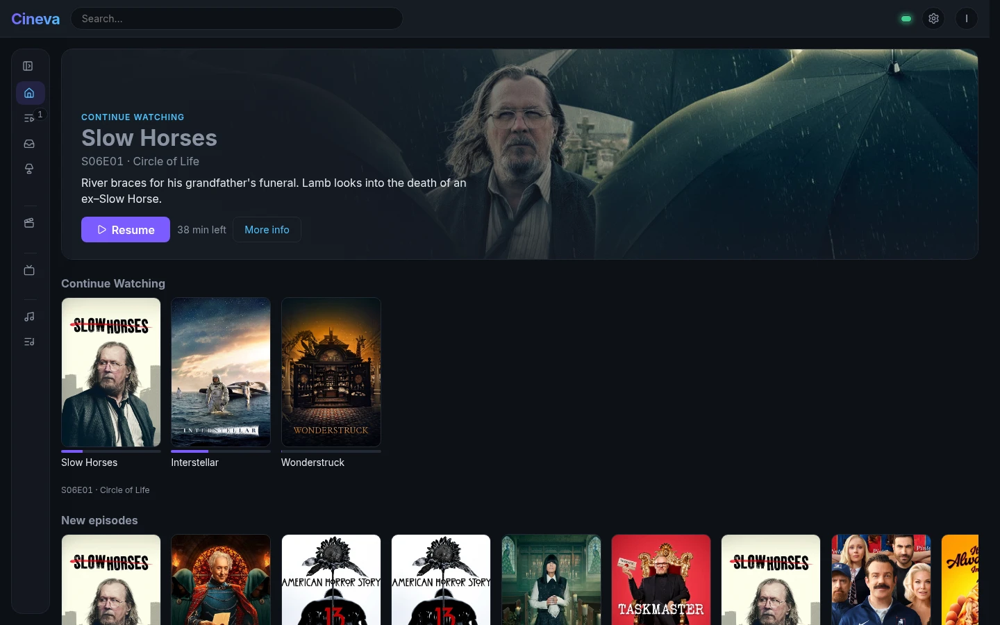
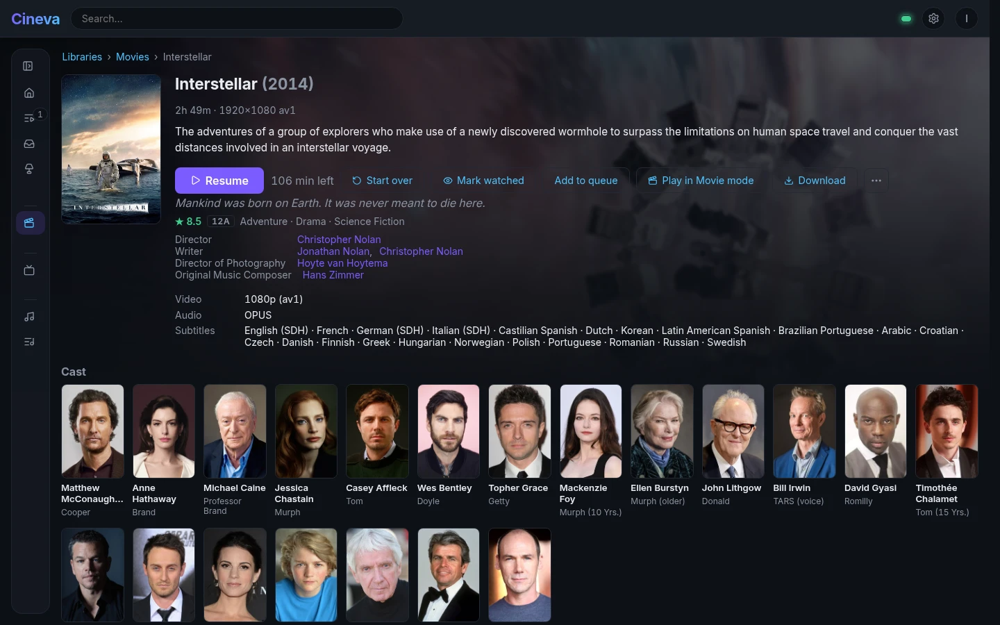
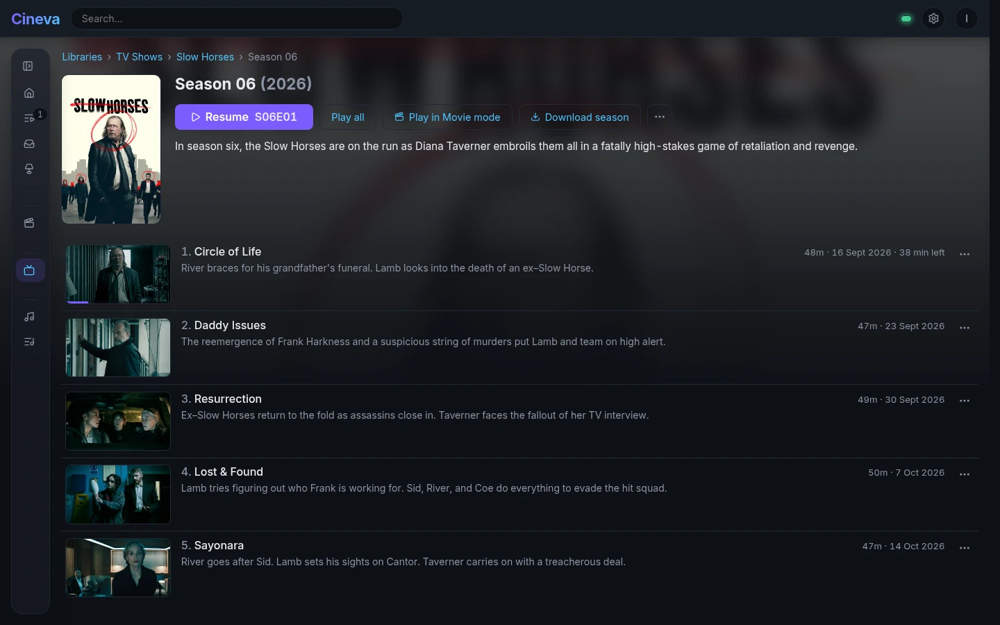
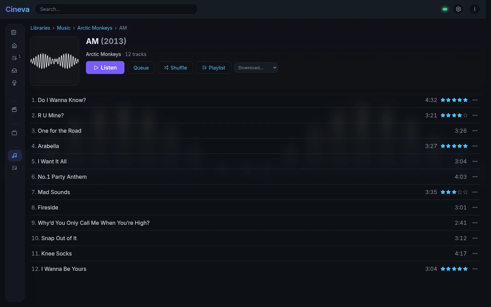
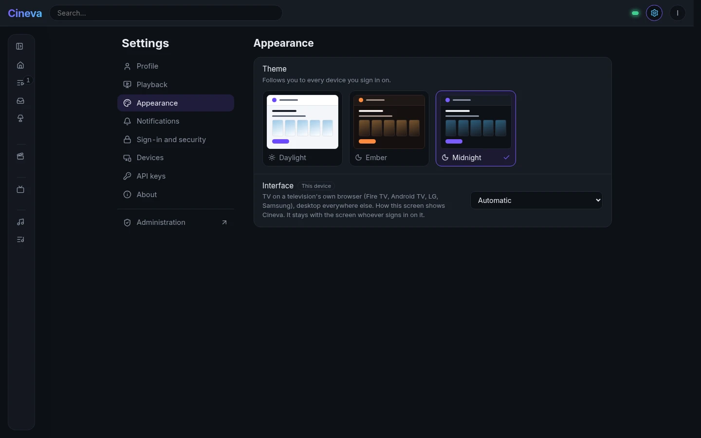
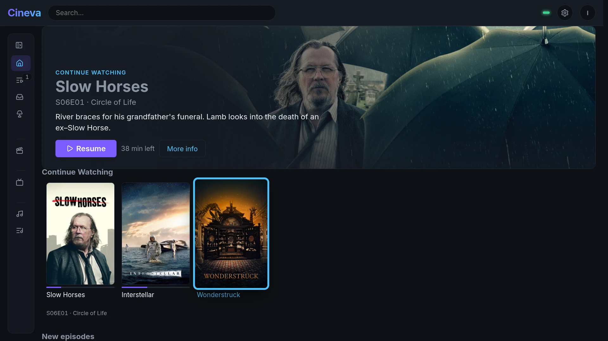
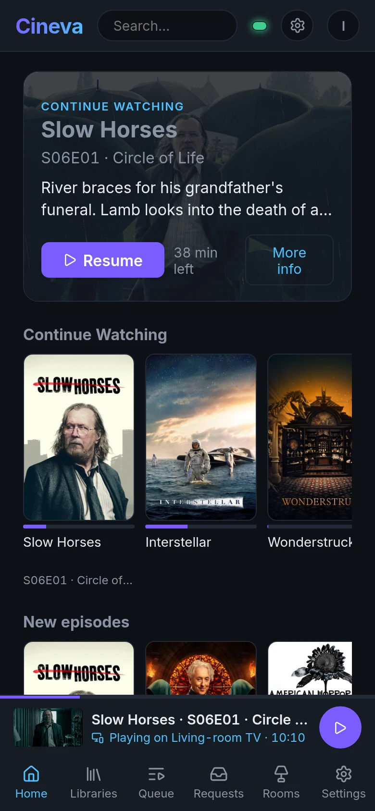
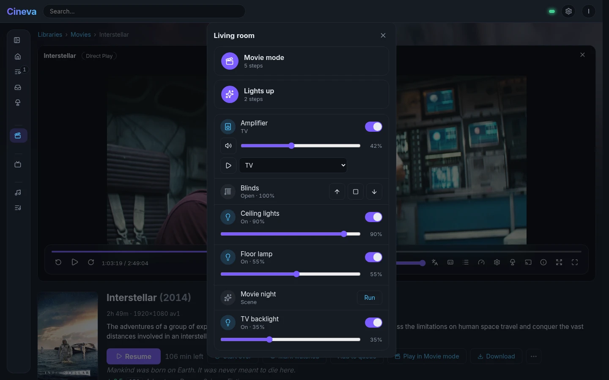
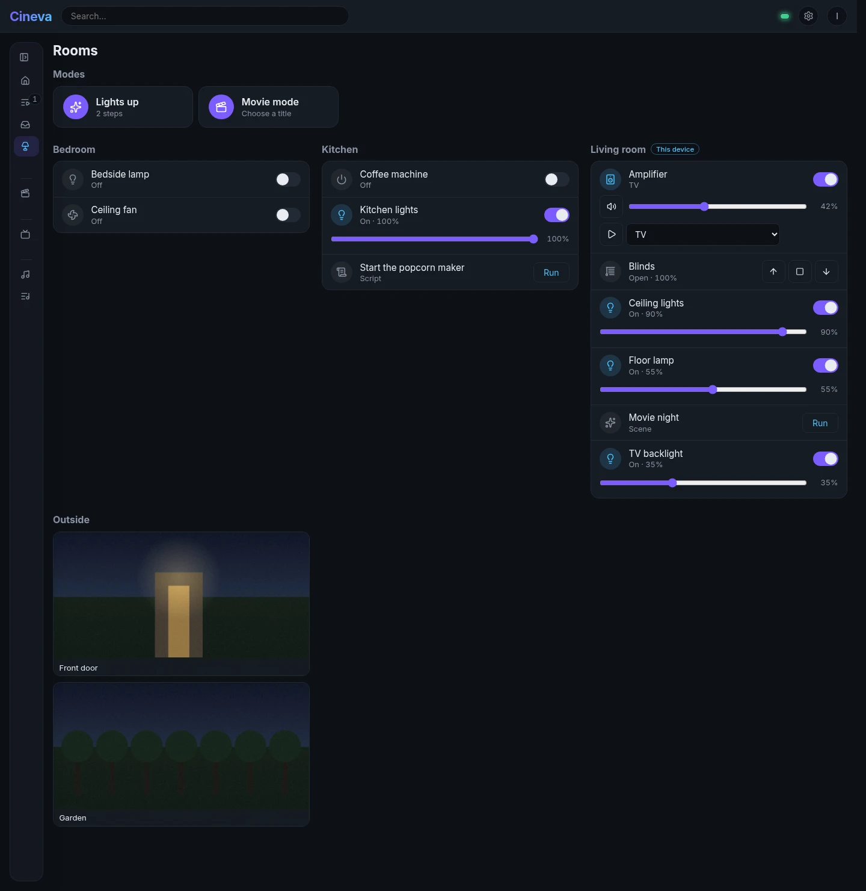
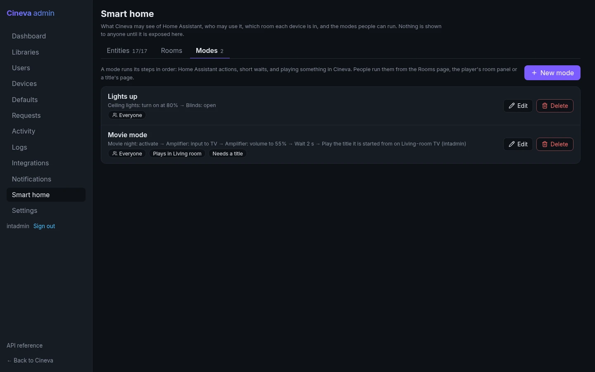

# Cineva

Cineva is a self-hosted media server for films, TV, music — and, in time,
audiobooks, podcasts, ebooks and comics. It scans your libraries, fetches
artwork and details, and streams to a browser on any device, transcoding on
the fly when a device cannot play a file as it is. It is one program: the web
client and the admin UI are built in, and there is nothing else to install.

It is written in Go for Linux, and is under active development. Video and
music are in daily use; audiobooks, podcasts and books are on the way.



## What it does

### Watching and listening

- **Libraries** — Movies, TV and Music, each pointing at one or more folders.
  Scans are incremental and run every 15 minutes by default, so new files
  appear on their own; Sonarr, Radarr and Lidarr can trigger one the moment
  they import something.
- **Metadata** — posters, backdrops, synopses, cast and episode details from
  TMDB; music from embedded tags, MusicBrainz and the Cover Art Archive.
  Search ignores case and accents: "amelie" finds *Amélie*.
- **Playback** — direct play when the browser can handle the file, otherwise
  HLS transcoding with seeking; hardware transcoding through VA-API (AMD and
  Intel) where available. Text subtitles are served as WebVTT, and the seek
  bar shows preview pictures.
- **Series** — next-up tracking, intro and credits detection from the audio
  episodes share (with "Skip intro", and times that can be corrected by
  hand), and an up-next card that autoplays the next episode.
- **Music** — albums and artists, gapless playback, play counts, star
  ratings, and playlists: made by hand, or smart playlists that fill
  themselves from rules ("rated four stars or more, not played in a month").
- **Continue here** — while one of your devices plays, the others offer to
  carry on: pick up on your phone what the TV is playing, and the TV pauses.
  A queue can also be sent the other way ("Play on…").
- **TV mode** — the same client sized for across the room and worked with a
  remote: arrow keys move between posters, Back goes back, and the player
  takes the remote. It switches on by itself in a television's own browser
  (Fire TV, Android TV, LG, Samsung).
- **Downloads** — any title can be downloaded for offline viewing; albums and
  artists as a ZIP, original or transcoded.
- **Installable** — the web client works at phone width and installs as an
  app (PWA). Three themes, each a preference that follows you.

### Your household

- **People** — accounts with passwords or a quick PIN, a "Who's watching?"
  profile picker with photos, groups, and per-library access. Everyone has
  their own preferences (audio and subtitle languages, quality, intro
  skipping, autoplay); an admin sets the defaults and can lock what is
  theirs to decide.
- **Devices** — every screen is a device you can name ("Living-room TV") and
  sign out remotely. A shared screen can sign itself in as a chosen profile,
  with "Switch user" a PIN away. The admin pages are never offered on a TV.
- **Home Assistant** — rooms, lights, blinds, the amplifier and cameras in
  Cineva, exposed only to the people the admin chooses. Modes such as "Movie
  mode" dim the lights, close the blinds, set the amplifier and start the
  film in one press, and the player shows the controls of the room it is in.
- **Requests** — people ask for films and series that are not there yet; an
  admin approves them (or lets some people skip that), and Sonarr or Radarr
  fetches them.
- **Notifications** — to ntfy, Gotify, Discord, Telegram or a webhook: for
  the household (a request waiting, something new, storage down) and for
  each person (their requests, new episodes of what they are watching).
- **Moving in** — bring watch history, music playlists and favourites over
  from Plex or Jellyfin.

## Screenshots

| | |
|---|---|
|  |  |
| A film | A season, ready to resume |
|  |  |
| An album, with ratings | Themes |
|  |  |
| TV mode, worked with a remote | Continue on the phone what the TV is playing |
|  |  |
| The living room's controls, from the player | Rooms, modes and cameras from Home Assistant |
|  | |
| Modes in the admin UI | |

The Home Assistant pictures are of a demonstration instance, not a real
house.

## Requirements

- Linux on amd64 (x86-64) or arm64.
- Either Docker, or for the plain binary: glibc 2.39 or newer — Ubuntu 24.04,
  Debian 13, Fedora 40 or later. The binary carries FFmpeg inside it but uses
  the system's C and C++ runtime libraries; the container image brings its
  own, so with Docker the host's versions do not matter.
- For hardware transcoding: a GPU with a VA-API driver (`mesa-va-drivers` or
  `intel-media-va-driver`; the container image includes both). Without one,
  Cineva transcodes in software.
- To watch: a browser from 2023 or later — Chrome or Edge 111, Firefox 113,
  Safari 16.2 (iOS and iPadOS 16.2 on phones and tablets). The interface's
  colours are mixed with CSS `color-mix()`, which older browsers lack.

## Running with Docker

The image is the easiest way in: it runs on any distribution, and includes
the GPU drivers for hardware transcoding.

```sh
docker run -d --name cineva \
  -p 4747:4747 \
  -v cineva-data:/data \
  -v /path/to/media:/media:ro \
  --device /dev/dri \
  --group-add "$(stat -c %g /dev/dri/renderD128)" \
  --restart unless-stopped \
  <dockerhub-user>/cineva:latest
```

- `/data` holds the database, the artwork cache and, if you want one, a
  `cineva.yaml`. Keep it on a volume or a host folder so it survives
  upgrades.
- Mount your media read-only and point libraries at the paths inside the
  container (`/media/Movies`, `/media/TV`).
- `--device /dev/dri` and `--group-add` (the host's `render` group) let it
  use the GPU; leave both out to transcode in software.
- Settings can also be passed as environment variables, for example
  `-e CINEVA_LOG_LEVEL=debug`.

With Compose:

```yaml
services:
  cineva:
    image: <dockerhub-user>/cineva:latest
    ports: ["4747:4747"]
    volumes:
      - cineva-data:/data
      - /path/to/media:/media:ro
    devices: ["/dev/dri:/dev/dri"]
    group_add: ["989"]  # the host's render group: stat -c %g /dev/dri/renderD128
    restart: unless-stopped
volumes:
  cineva-data:
```

Upgrade with `docker pull` and recreating the container; the database
migrates itself on start.

## Installing the binary

Download the binary for your machine from the
[Releases](https://github.com/garybowers/cineva/releases) page, along with
`SHA256SUMS`, and install it:

```sh
sha256sum --check --ignore-missing SHA256SUMS
sudo install -m 755 cineva-linux-amd64 /usr/local/bin/cineva
cineva version
```

With the GitHub CLI: `gh release download --repo garybowers/cineva --pattern 'cineva-linux-*' --pattern SHA256SUMS`.

## First run

Cineva keeps its database, artwork cache and configuration in the directory
it is started from. Give it a directory of its own:

```sh
sudo mkdir -p /var/lib/cineva && sudo chown "$USER" /var/lib/cineva
cd /var/lib/cineva
cineva serve
```

Run it from a directory of its own rather than from wherever the binary
sits: Cineva looks for a configuration file called `cineva` in its working
directory, and a binary of that name there would be read as one.

Then open `http://<server>:4747` in a browser:

1. The first visit asks you to create the admin account. (Or create it from
   the command line: `cineva user add <name> --admin`.)
2. Open the admin UI (`http://<server>:4747/admin`, or "Admin" in the account
   menu), choose **Libraries**, and add a library: its type — Movies, TV or
   Music — and the folders it should scan.
3. Press **Scan** on the new library — or leave it to the scheduled rescan,
   which picks it up within 15 minutes. Titles appear as they are found.

Release binaries include a TMDB API key. A binary built without one needs a
key of your own (free from [themoviedb.org](https://www.themoviedb.org/settings/api)),
set as `metadata.tmdb.api_key` in the configuration.

### Running as a service

```ini
# /etc/systemd/system/cineva.service
[Unit]
Description=Cineva media server
After=network-online.target
Wants=network-online.target

[Service]
User=cineva
Group=cineva
# render: access to the GPU for hardware transcoding
SupplementaryGroups=render video
WorkingDirectory=/var/lib/cineva
ExecStart=/usr/local/bin/cineva serve
Restart=on-failure

[Install]
WantedBy=multi-user.target
```

```sh
sudo useradd --system --home /var/lib/cineva cineva
sudo chown -R cineva:cineva /var/lib/cineva
sudo systemctl enable --now cineva
```

The `cineva` user needs read access to your media folders.

## Configuration

Settings come, in order of precedence, from command-line flags, `CINEVA_*`
environment variables, a configuration file, and built-in defaults. The file
is `cineva.yaml` in the working directory, else `/etc/cineva/cineva.yaml`, or
wherever `--config` points.
[`server/cineva.example.yaml`](server/cineva.example.yaml) lists every setting
with its environment variable; the ones most often changed:

| Setting | Default | Environment variable |
|---|---|---|
| `server.port` | `4747` | `CINEVA_SERVER_PORT` |
| `database.path` | `cineva.db` | `CINEVA_DATABASE_PATH` |
| `libraries.artwork_dir` | `artwork` | `CINEVA_LIBRARIES_ARTWORK_DIR` |
| `libraries.scan_interval` | `15m` (`0` turns it off) | `CINEVA_LIBRARIES_SCAN_INTERVAL` |
| `transcode.dir` | a directory under `/tmp` | `CINEVA_TRANSCODE_DIR` |
| `transcode.hwaccel` | `auto` | `CINEVA_TRANSCODE_HWACCEL` |
| `metadata.tmdb.api_key` | built in to releases | `CINEVA_METADATA_TMDB_API_KEY` |
| `auth.secure_cookies` | `false` — set `true` behind HTTPS | `CINEVA_AUTH_SECURE_COOKIES` |
| `log.level` | `info` (`debug`, `warn`, `error`; or `--log-level`) | `CINEVA_LOG_LEVEL` |
| `log.format` | `auto` — readable in a terminal, JSON otherwise | `CINEVA_LOG_FORMAT` |

`cineva config validate` prints the effective configuration.

Other commands: `cineva scan [library]` scans from the command line, and
`cineva user add` / `cineva user passwd` create accounts and reset passwords.

## API

Everything the web client does goes through a REST API, which apps and
scripts can use too: create an API key under Account settings and send it as
`Authorization: Bearer <key>`. An interactive reference is served at
`http://<server>:4747/api/docs`, and the OpenAPI 3.1 specification it is built
from at `/api/v1/openapi.yaml`, for generating client libraries.

## Integrations

All of these are set up in the admin UI, under **Integrations**.

- **Sonarr, Radarr and Lidarr** — add each with its URL and API key (in
  Sonarr: Settings, General, Security). Cineva registers a webhook called
  "Cineva" in it, and from then on each import, upgrade, rename or deletion
  triggers a rescan of the affected library. If it runs in a container or
  on another machine, set "Cineva address" to the address it can reach
  Cineva on. Sonarr and Radarr also take the requests people make, each
  with a default quality profile and folder.
- **Home Assistant** — add its address and a long-lived access token (made
  on your profile page in Home Assistant). Then, on **Smart home**: expose
  the entities Cineva may use and choose who may use each (cameras start
  admins-only), put devices in rooms, and build modes. Cineva also fires
  `cineva_playback_*` events into Home Assistant, for automations such as
  raising the lights on pause.
- **Notifications** — household destinations are added under
  **Notifications**; each person adds their own in Settings.
- **Plex and Jellyfin** — **Users**, then "Import from Plex or Jellyfin":
  match the old server's users to Cineva's (or create them), run a dry run
  to see what does not match, then import. Running it twice changes
  nothing, and newer Cineva state is never overwritten.

## Building from source

You need Go 1.27, Node.js 22, git and a C compiler. Building the FFmpeg
library additionally needs `yasm nasm meson gperf python3` and a Rust
toolchain with `cargo-c` (`cargo install cargo-c`).

```sh
git clone --recurse-submodules git@github.com:garybowers/cineva.git
cd cineva
make setup   # builds the static FFmpeg library (slow, once) and installs the UI dependencies
make ui      # builds the web client, admin UI and API reference (make build does this too)
make run     # runs the server from server/
make build   # writes bin/cineva
```

`make test` and `make lint` run the Go tests and checks. To compile a TMDB key
into your builds, put `TMDB_KEY = <key>` in `local.mk` at the top of the
repository — it is ignored by git.

The FFmpeg library is built from source, with a patch adding the Linux VA-API
hardware decoders, rather than downloaded; [CLAUDE.md](CLAUDE.md) explains
why, and describes the code's layout and conventions.

### Releases

Every push and pull request is built and tested by GitHub Actions
([`.github/workflows/ci.yml`](.github/workflows/ci.yml)). Pushing a tag that
starts with `v` also publishes a release:

```sh
git tag v0.2.0
git push origin v0.2.0
```

The release carries `cineva-linux-amd64`, `cineva-linux-arm64` and
`SHA256SUMS`, with the version stamped into the binary, and the same binaries
go to Docker Hub as a two-architecture image tagged `0.2.0`, `0.2`, `0` and
`latest`. A tag with a hyphen (`v0.2.0-rc.1`) is published as a pre-release,
and its image gets only its own tag, never `latest`.

To build the image locally, put a binary in `dist/` and build:

```sh
make build OUT=dist/cineva-linux-amd64
docker build -t cineva .
```

A binary built on a recent rolling distribution may need a newer glibc than
the image's Debian 13 provides; release binaries are built on Ubuntu 24.04
for that reason.

The workflow uses repository settings: a `TMDB_KEY` secret for the built-in
key; `DOCKERHUB_USERNAME` and `DOCKERHUB_TOKEN` secrets and a
`DOCKERHUB_REPOSITORY` variable (for example `garybowers/cineva`) to publish
the image; and an optional `ARM64_RUNNER` variable to build arm64 somewhere
other than GitHub's arm64 runners.

## Contributing

Bug reports, ideas and pull requests are welcome — see
[CONTRIBUTING.md](CONTRIBUTING.md) for how to set up, what a change needs, and
how it is reviewed.

## Licence

Copyright (C) 2026 Gary Bowers.

Cineva is free software, licensed under the GNU Affero General Public Licence,
version 3 or (at your option) any later version — see [LICENSE](LICENSE). You
may use, study, change and share it. If you distribute it, or run a modified
version as a service that other people use over a network, you must offer
them its source code under the same licence.

The binaries also contain FFmpeg, built with GPL-licensed components (x264,
x265) under the GPL version 3, which is compatible with Cineva's licence.
The FFmpeg bindings, ffmpeg-statigo, are MIT-licensed.

Cineva uses the TMDB API but is not endorsed or certified by TMDB.
